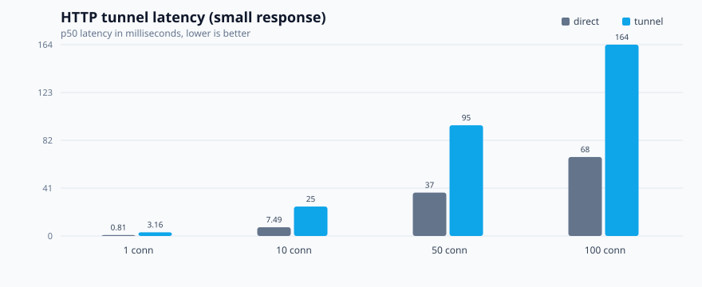
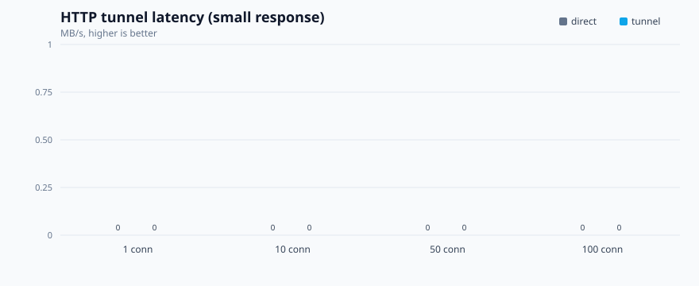

# Wormhole benchmark results

Generated 2026-10-23T13:06:44.726Z on win32 x64, Node v22.16.0.
Each measurement ran for 3s with one-request-per-connection HTTP load.

## Results

| Scenario | Target | Connections | Req/s | p50 | p99 | Max | MB/s | Errors |
|---|---|---:|---:|---:|---:|---:|---:|---:|
| download-1mb | direct | 1 | 235.29 | 3.67 ms | 18.68 ms | 30.72 ms | 235.29 | 0 |
| download-1mb | tunnel | 1 | 58.77 | 15.5 ms | 39.58 ms | 45.12 ms | 58.77 | 0 |
| download-1mb | direct | 10 | 309.06 | 30.91 ms | 52.89 ms | 61.2 ms | 309.06 | 0 |
| download-1mb | tunnel | 10 | 73.97 | 134.73 ms | 153.66 ms | 157.16 ms | 73.97 | 0 |
| small | direct | 1 | 1062.52 | 0.81 ms | 2.19 ms | 6.04 ms | 0 | 0 |
| small | tunnel | 1 | 294.47 | 3.16 ms | 6.51 ms | 28.92 ms | 0 | 0 |
| small | direct | 10 | 1238.97 | 7.49 ms | 15.15 ms | 26.95 ms | 0 | 0 |
| small | tunnel | 10 | 378.59 | 25.24 ms | 49.64 ms | 60.02 ms | 0 | 0 |
| small | direct | 50 | 1345.38 | 37.21 ms | 49.88 ms | 52.79 ms | 0 | 0 |
| small | tunnel | 50 | 522.78 | 94.96 ms | 111.05 ms | 112.19 ms | 0 | 0 |
| small | direct | 100 | 1441 | 67.73 ms | 114.91 ms | 119.33 ms | 0 | 0 |
| small | tunnel | 100 | 609.34 | 164.09 ms | 198.65 ms | 201.13 ms | 0 | 0 |
| upload-300kb | direct | 1 | 427.9 | 1.42 ms | 17.42 ms | 26.14 ms | 0 | 0 |
| upload-300kb | tunnel | 1 | 151.78 | 5.88 ms | 15.1 ms | 29.8 ms | 0 | 0 |
| upload-300kb | direct | 10 | 693.21 | 13.54 ms | 25.71 ms | 43.02 ms | 0 | 0 |
| upload-300kb | tunnel | 10 | 194.98 | 50.62 ms | 69.56 ms | 72.24 ms | 0 | 0 |

## Tunnel overhead

| Scenario | Connections | Direct p50 | Tunnel p50 | Added latency | Throughput ratio |
|---|---:|---:|---:|---:|---:|
| small | 1 | 0.81 ms | 3.16 ms | 2.35 ms | 27.7% |
| small | 10 | 7.49 ms | 25.24 ms | 17.75 ms | 30.6% |
| small | 50 | 37.21 ms | 94.96 ms | 57.75 ms | 38.9% |
| small | 100 | 67.73 ms | 164.09 ms | 96.36 ms | 42.3% |
| download-1mb | 1 | 3.67 ms | 15.5 ms | 11.83 ms | 25.0% |
| download-1mb | 10 | 30.91 ms | 134.73 ms | 103.82 ms | 23.9% |
| upload-300kb | 1 | 1.42 ms | 5.88 ms | 4.46 ms | 35.5% |
| upload-300kb | 10 | 13.54 ms | 50.62 ms | 37.08 ms | 28.1% |

## Charts

