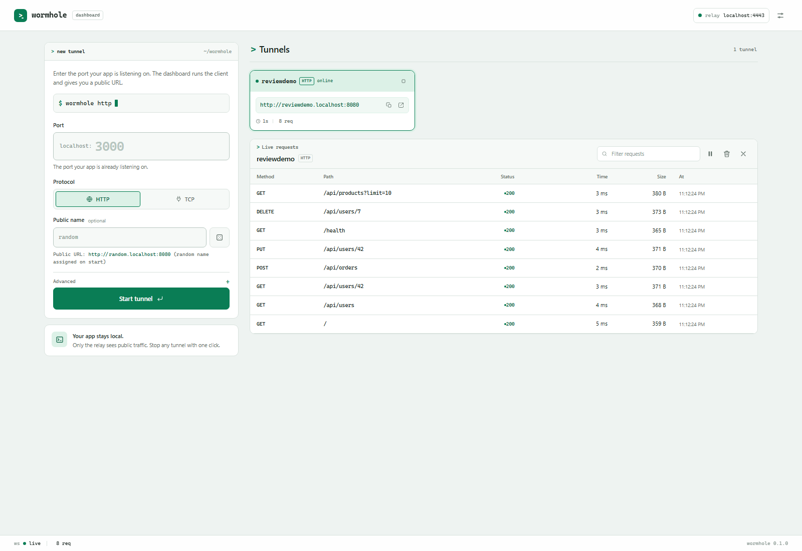
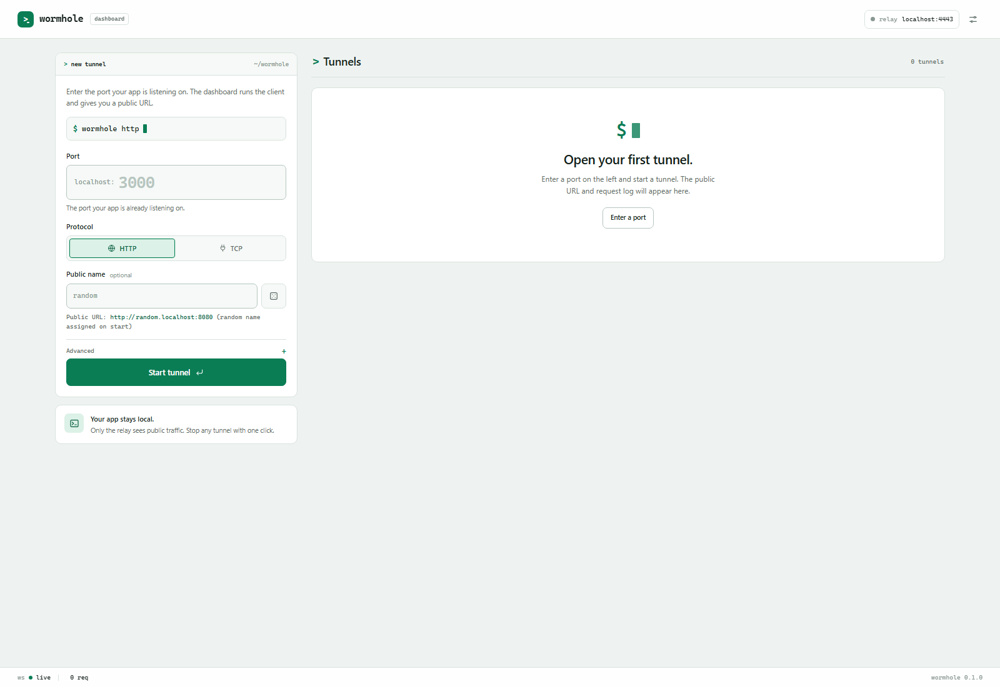

# @wormhole/dashboard

A local web dashboard for starting, stopping and inspecting Wormhole tunnels.
It replaces the CLI for day-to-day use: enter a port, click **Start tunnel**, and
the public URL and live request log appear in the browser.



First run — enter a port and launch:



## Run

From the repository root, use two terminals:

```sh
npm install       # once
npm run server    # terminal 1: the relay
npm run dashboard # terminal 2: the dashboard
# or: npx wormhole-dashboard
```

The dashboard opens at <http://localhost:4040>. If your browser does not open it
automatically, visit that URL. The default settings match `server/config.yaml`
(`localhost:4443` and the development token), so the first tunnel works
immediately.

1. Enter the port your app is running on (for example `3000`).
2. Leave **Public name** blank for a random subdomain, or type a name.
3. Click **Start tunnel**.
4. Point traffic at the public URL. Requests appear in the inspector below.

The relay still needs to be running. The dashboard manages **client-side**
tunnels only; it does not start or configure the relay.

> The CLI inspector also defaults to port `4040`. Run the dashboard **or** a
> CLI inspector, not both; use `--port 4041` for the dashboard if you need both.

> On some systems `*.localhost` does not resolve in the browser. The card's
> **Open** button is best-effort; for public traffic you can always use the
> copied URL, or `curl -H "Host: <subdomain>.localhost:8080" http://localhost:8080/`.

## What it does

- Start and stop any number of HTTP and raw TCP tunnels.
- Show status, public URL, local target, uptime and request count per tunnel.
- Copy or open the public URL.
- Live HTTP request inspector: method, path, status, timing, size.
- Request detail: headers and bodies (first 16 KB), JSON pretty-printing.
- **Replay** a captured request to the local app.
- Filter requests, pause live updates, clear the log.
- Reconnect automatically; the card shows the backoff state and the same HTTP
  subdomain is retained.
- Settings for relay, token override, default local host, public URL preview and
  TLS verification. Settings are stored in `localStorage`.
- Responsive light terminal UI; no build step, no frontend framework.

## Design

The interface is a light terminal workspace: a white command window on a cool
paper canvas, a single emerald signal for the primary action and live state, and
monospaced data for ports, URLs and paths. The command preview mirrors the CLI
and updates as you type. Tunnel cards read as terminal panes, and the selected
session is tinted and outlined rather than inverted. Panels use fine rules and
soft surfaces instead of gradients and heavy shadows; a fixed status line keeps
the WebSocket connection and request count visible.

The UI is responsive down to mobile, uses visible focus states, respects
`prefers-reduced-motion`, and never relies on colour alone for tunnel state.

## Configuration

The process defaults can be set with environment variables:

| Variable | Default | Meaning |
|---|---|---|
| `WORMHOLE_SERVER` | `localhost:4443` | Relay control server |
| `WORMHOLE_TOKEN` | `dev-token-please-change` | Default auth token |
| `WORMHOLE_LOCAL_HOST` | `localhost` | Default local host |
| `WORMHOLE_PUBLIC_BASE` | `http://localhost:8080` | Base used to preview public URLs |

CLI options:

```sh
npx wormhole-dashboard --port 4041 --no-open
npx wormhole-dashboard --server relay.example.com:4443 --token "$WORMHOLE_TOKEN"
```

`npm run dashboard` with no arguments uses the defaults. Use the
`wormhole-dashboard` bin (or `npx tsx dashboard/src/cli.ts`) when you need to
pass flags.

| Option | Default | Description |
|---|---|---|
| `-p, --port <port>` | `4040` | Dashboard port (`0` picks a free port) |
| `--host <host>` | `127.0.0.1` | Bind interface |
| `--server <host:port>` | env/default | Default relay |
| `--token <token>` | env/default | Default auth token |
| `--public-base <url>` | env/default | Public URL preview base |
| `--no-open` | off | Do not open the browser |
| `-h, --help` | | Show help |

The relay token is **not** sent to the browser by the server. The form uses the
dashboard process's default unless you enter an override in Settings, which is
kept in `localStorage` for this browser only.

## API

The dashboard binds to `127.0.0.1` by default and serves a small local API:

| Method | Path | Purpose |
|---|---|---|
| GET | `/api/config` | Defaults, token presence and current tunnels |
| GET | `/api/tunnels` | Tunnel snapshots |
| POST | `/api/tunnels` | Start a tunnel |
| DELETE | `/api/tunnels/:id` | Stop a tunnel |
| GET | `/api/tunnels/:id` | One tunnel snapshot |
| GET | `/api/tunnels/:id/requests` | Captured HTTP requests |
| GET | `/api/tunnels/:id/requests/:rid` | One request with headers/bodies |
| POST | `/api/tunnels/:id/requests/:rid/replay` | Replay a request |
| DELETE | `/api/tunnels/:id/requests` | Clear the request log |
| GET | `/api/health` | Liveness and tunnel count |
| WS | `/ws` | Snapshot, then live tunnel/request messages |

Writes are same-origin only. Cross-origin `POST`, `DELETE` and WebSocket
connections are rejected, so another website open in the browser cannot control
your tunnels. The server also sets a strict Content Security Policy.

## Architecture

```
dashboard/public/           static HTML, CSS and vanilla JS
dashboard/src/manager.ts    TunnelManager: one TunnelClient per tunnel
dashboard/src/server.ts     HTTP API, static files, WebSocket broadcast
dashboard/src/cli.ts        `npm run dashboard` entry point
```

`TunnelManager` wraps the existing `@wormhole/client` `TunnelClient` and gives
each HTTP tunnel its own `RequestStore` from `@wormhole/inspector`. There is no
new protocol and no relay change. Each tunnel is still one outbound TLS
connection using the existing multiplexer.

Events pushed over `/ws`:

- `snapshot` — current tunnels when a tab connects
- `tunnel` — a tunnel was created or changed
- `remove` — a tunnel was stopped
- `request` — a captured request was created or updated
- `clear` — a request log was cleared

## Tests

```sh
npx vitest run dashboard/test
npm run typecheck
```

The dashboard adds tests for input validation and the HTTP API (including
same-origin write protection).

## Limitations

- HTTP request inspection only; TCP tunnels show status and active connections.
- The relay must be started separately (`npm run server`).
- Request history is in memory (200 records per tunnel) and is lost when the
  tunnel is stopped.
- No user accounts or remote access. The dashboard is a local developer tool;
  keep it bound to loopback. Use `--host 0.0.0.0` only on a trusted network.
- TLS verification is off by default because the development relay uses a
  self-signed certificate. Enable it in Settings when the relay has a trusted
  certificate.
- The public URL preview is cosmetic; the relay's assigned URL always wins.
